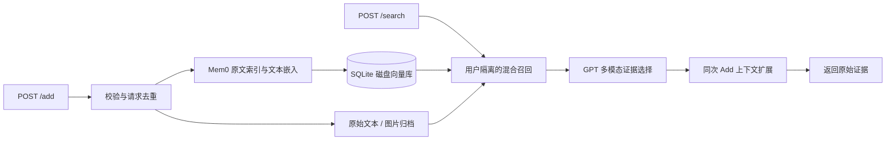

# TraceMem-MM

面向多模态对话的长期记忆服务：保留原始文本与图片，按用户隔离检索，返回可追溯的原始证据。

当前最终实现为 **v4.3.15-rc7**，服务入口是 `agent_memory.gpu6_app:create_gpu6_app`。模型使用 `text-embedding-v4`（256 维文本向量）与 `gpt-4o-mini`（多模态证据选择）。

## 架构



- **写入**：保留原始内容与来源标识；使用 Mem0 原文模式，文本嵌入按同次 Add 有界分批准备，原生存储写入串行化。媒体预处理结果仅在当前请求内复用。
- **检索**：融合向量检索、BM25 与图片精确匹配；可选 `options` 作为不可信查询上下文，不写入记忆。GPT 从有界候选中选择证据，再补充相邻上下文；服务不生成问题答案。
- **存储与并发**：SQLite 保存来源、磁盘向量、请求回执与费用账本；向量按批精确余弦扫描，避免全量常驻内存。最终服务采用单进程写入、16 路有界并发。
- **可靠性**：模型调用前持久绑定账本 attempt 与回执，保留失败及结果未知的记录；重试有界、每次单独记账。就绪检查通过异常索引减少历史扫描，TLS 校验与用户隔离保持启用。

## 本地运行

Python 3.11+，在仓库根目录执行：

```bash
python -m agent_memory
python scripts/run_checks.py
```

第一条运行合成数据的离线演示；第二条运行离线测试，包含临时本机 HTTP 集成测试，不调用付费模型。原生 Mem0 测试需要额外依赖，缺失时会标记跳过；固定依赖见 `requirements-mem0.txt`，容器构建入口为 `Dockerfile.mem0`。

线上工厂保留专用部署的显式授权、状态目录、代理与租期约束，不是通用的一键启动配置。部署边界见 [GPU6 服务说明](docs/gpu6-full-migration.md)，磁盘存储细节见 [向量存储](docs/disk-vector-storage.md)。仓库中的其他服务工厂、Compose 文件与研究文档保留作历史实现参考。

## 目录

| 路径 | 内容 |
| --- | --- |
| `agent_memory/` | API、Mem0 适配、混合检索、证据选择、存储与回执 |
| `tests/`、`fixtures/` | 离线回归测试与合成样例 |
| `deploy/`、`Dockerfile.mem0` | 服务进程配置与固定依赖容器 |
| `docs/` | 架构细节、存储与恢复机制 |

仅公开源码与合成样例，不包含模型密钥、私有运行数据库或评测数据。

## 许可

[MIT License](LICENSE)；第三方组件归属与许可见 [NOTICE.md](NOTICE.md)。
