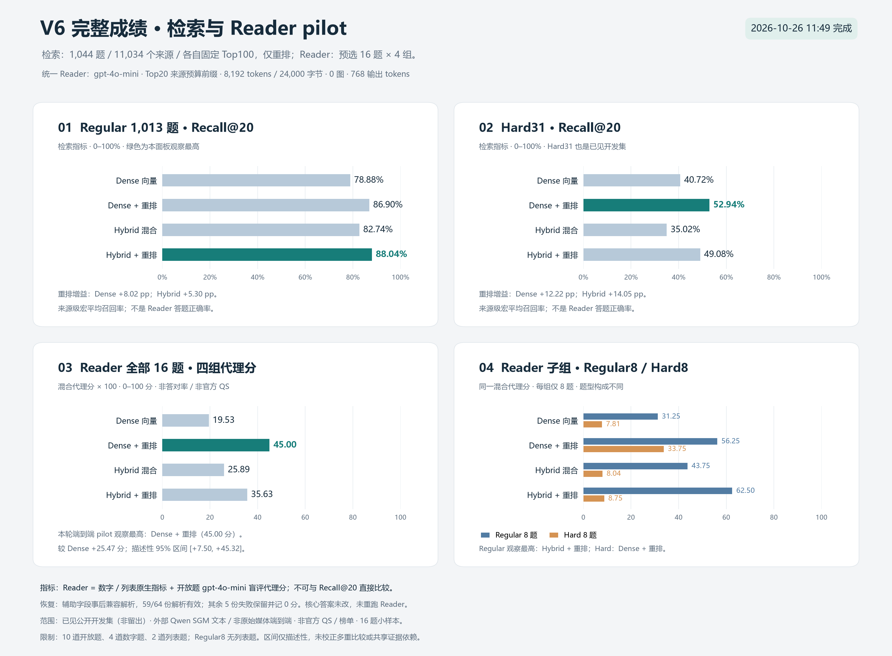

# TraceMem-MM

Current fixed service: **tracemem-mm-bailian-v2.0.4**, release
`790e2d73816eefd5ab8b5f11b4ee7056781026bd`, at
[/v2.1/health](https://45.192.104.173/v2.1/health) (same-version alias `/v2.2`).
Its official compatibility Smoke completed successfully. This does not establish
strong retrieval quality or a Full/public leaderboard result. The old `/v2`
route is retired. Evaluation credentials and private task receipts are not in
this repository.

The separate [evidence-context candidate](docs/evidence-context-candidate.md),
`tracemem-mm-context-v2.1.0-rc1`, is a library-only successor with synthetic
regression checks. It is not selected by a service factory or deployed, and has
no new real-model benchmark or official score. The fixed v2.0.4 stays unchanged.

## Historical engineering milestones

The sections below retain earlier results and their original limitations. They
are not the current deployment or admission state. Hosted `qwen3-vl-rerank` is a
different model identity from the original fixed local Qwen 2B weights.

**Current admission candidate: `tracemem-mm-online-v1.0.0`.** The production profile and operational bounds are documented in [official-service-v1](docs/official-service-v1.md). It uses the exact validated GPT / embedding / Qwen pipeline, one migrated original budget, private GPU supervision, TLS, and automatic evaluation-data deletion. 616 offline checks pass. Historical milestones below describe earlier states; official admission/score is not implied by these checks.

Public endpoint: [health](https://45.192.104.173/health); authenticated Add/Search
use the same host. The final native-data deployment preflight passed 2 Add /
2 Search with 4 real GPT calls, 4 real embedding calls, and 8 fixed-Qwen scoring
pairs. Idempotence, isolation, restart persistence and original-evidence checks
passed. One GPT auxiliary-metadata failure was recovered from its saved response
without replay; see [preflight evidence](reports/public-api-preflight.json).

## 已完成的完整场景在线回归

**2026-10-27：同一在线实例的真实数据验收已完成。** GPT 原始图片卡片、text-embedding-v4 DenseTop100 和固定 `Qwen/Qwen3-VL-Reranker-2B` 已连通；型号、revision 和权重哈希必须匹配，百炼托管 alias 未接入。

完整旧场景 186 Add / 74 Search、幂等、冲突拒绝、用户隔离和重启持久化全部通过。实际 GPT 372 次、embedding 260 次，Qwen 7,400 对；632 份提供方收据完整，按原预算核对。前 20 条 API 消息的证据召回为 **90.52%**（60 个有证据问题，14 个空证据问题不计分母）。这是此前场景的部署回归，粒度与旧 V7 不同，不能直接作同条件比较。

该回归完成时有 598 项离线检查；当前服务候选已有 616 项检查通过，并已部署公网 HTTPS。原 632 次回归授权已用完，公共服务使用同一原始预算账本。详见[在线验收与限制](docs/online-native-candidate.md)和[汇总证据](reports/online-native-acceptance.json)。

## 已完成的 V7/V7.1 研究

**V7独立场景检索、V7.1引用接口回归已完成。** Mem-Gallery完整186轮/74题，8,831个真实GPU重排对。Dense＋重排的Recall@20为94.62%，Dense为88.73%；Hybrid＋重排93.78%，Hybrid84.13%。

16题Reader的严格代理分为Dense54.69、Dense＋重排56.25、Hybrid56.25、Hybrid＋重排56.25。配对区间跨零，尚未证明稳定的回答提升。V7.1消除了引用ID错误，但仍有14/64份拒答状态不一致，均计零；保留原V7的58/64无效结果和全部失败记录。

本轮164次真实API请求（27embedding、128reader、8成功Judge、1被拒Judge），费用与预留分别记账。V7.1是同场景工程回归、作者caption文本条件，**不是正式发布或官方榜单成绩**。Dense＋重排继续作为主候选；默认服务仍保留独立的确定性配置。早期 3 次真实 embedding、1 次容器内 GPT 卡片调用及独立 GPU 上 6 对 Qwen 重排 smoke 记录见[先前准入准备与组件 smoke](docs/competition-readiness-20261026.md)；当前整体验收见上方。

完整结果、图表、置信区间与调用审计见[V7/V7.1结果](docs/v7-independent-scene.md)。[V6结果](docs/v6-results.md)、[V5结果](docs/v5-results.md)和[开源方法核查](docs/opensource-methods-20261025.md)保留为历史里程碑。当前研究代码使用私有[Draft PR #1](https://github.com/cenzihan/trace-mem-mm/pull/1)继续迭代。最终源码517项、发布副本493项工程测试通过。


Research prototype for the Academic Multimodal Agent Memory Leaderboard.
Public authenticated HTTPS APIs are deployed; organizer acceptance, official Smoke
and Full are not established by local tests.

## Docker deployment and embedding smoke

**The baseline still serves deterministic Add/Search. A separate online Dense +
rerank candidate has now passed private native-data acceptance.** The baseline
is deployed on the user's Ubuntu 24.04 server. The image has
a pinned Python base digest, authenticated API, non-root execution, persistent
SQLite volume, bounded resources and rotated logs. Host access defaults to an
SSH tunnel. A Linux CI job builds and validates real containers, including
recreation and backup/restore into a fresh volume. Its status and aggregate
artifact are the evidence for container validation; source tests alone do not
confirm an image build. A separate bounded profile completed three real
text-embedding-v4 calls, authenticated Add/Search and recreation persistence.
Its receipts were reconciled against the same three original parent-ledger holds;
the smoke container was removed and its temporary provider key deleted, with
private evidence retained. The initial GPT regional HTTP403 was preserved. After
the user changed the configuration, one real GPT card request inside the deployed
container succeeded, and a separate six-pair Qwen GPU smoke passed. These are
component checks; the running Add/Search baseline still has dense/rerank disabled.
See the [current application requirements and evidence](docs/competition-readiness-20261026.md).
The current public API candidate is described above; these historical component
checks are not official Smoke or leaderboard results.

Read the [server setup, Docker validation and integration plan](docs/docker-deployment.md),
[real embedding smoke evidence and runbook](docs/embedding-model-smoke.md),
[RAW-RAG / DSH design comparison](docs/raw-rag-dsh-design.md), and
[clean-export provenance](docs/export-provenance.md). This publication uses a
new snapshot based on the previous remote main, omitting unpublished history
that contained upstream benchmark examples in documentation.

## V6 reranking and recovered reader pilot complete (2026-10-26)

The Raw-RAG-inspired V6 ablation freezes each V5 Dense/Hybrid Top100 pool and
adds one fixed candidate-only Qwen3-VL-Reranker-2B. The 1,044 public development
questions required 145,629 unique pairs, all completed on four private-host GPUs.
Regular Recall@20 peaks at 88.04% for Hybrid+rerank; Hard31 peaks at 52.94% for
Dense+rerank. Each retriever's Top100 coverage is unchanged. No new embeddings.

The ID-selected 16-question, four-condition pilot made 64 real gpt-4o-mini reader
calls. An auxiliary-field parser bug initially invalidated all outputs. Additive
receipt recovery restored 59 answers without changing answer text; five substantive
failures remain scored zero. Five new blinded judge batches replaced the unusable
old grades. Dense+rerank has the highest observed mixed proxy score, 45.00/100.
This small, balanced public-development pilot is not official QS or a heldout test.

Total V6 API calls are 79 (64 reader +10 old judge +5 recovery judge), with no
repeated reader call. Both guards are closed; the combined CNY19.75 preflight hold
stays below the original 80-call/CNY20 limit within CNY500. Usage-estimated API
cost is USD0.06349305, distinct from the retained budget holds. Source/export
regressions passed 401/366 tests. See [results and limitations](docs/v6-results.md)
and [frozen design](docs/v6-rerank.md).



V6 host-specific scripts are included for audit and require explicit execution
flags and the already-prepared private artifacts. They contain no credentials
or benchmark payloads. Do not run them against a different host without adapting
and re-freezing a separate experiment; the default Add/Search service is unchanged.

## Completed local experiment: V5 real embeddings (2026-10-25)

V5 adds a source-only, content-addressed `text-embedding-v4` cache and full-corpus
dense / flat+dense RRF60 retrieval over the same published vectors. It preserves
native source IDs and rejects incomplete publication. Public evaluation queries
have a separate private cache and never enter source memory.
Completed values may be reused; missing values never authorize retrying an unknown
provider attempt. A durable batch executor now commits receipts before parsing,
binds budget attempts to run ordinals, and stops unknown requests without replay.

The complete local manifest contains 11,034 sources / 11,035 text chunks, requiring
1,104 source embedding batches, followed by 105 batches for 1,044 original queries.
The owner's real run completed at 17:45 UTC+8. All 1,209 requests returned HTTP200,
with CNY1.912700 usage-estimated cost; the single run guard is complete. On the
1,013 regular questions, Recall@20 is 73.83% flat / 78.88% dense / 82.74% hybrid.
On Hard31, it is 14.13% flat / 40.72% dense / 35.02% hybrid. These are previously
evaluated public development sets with author-provided Qwen SGM text; no new
reader accuracy or official score is claimed.
Inherited visual receipt recovery was also hardened against malformed/ambiguous JSON,
credential echoes in object keys, and tampered manifests before dispatch.

The curated checkout passed **277 offline tests**. For the optional image
auditing/recovery tests, install the `audit` extra
(`python -m pip install -e ".[audit]"`) before running `python -B scripts/run_checks.py`.
The cache and dense retrieval modules themselves use only the standard library.
See [V5 results](docs/v5-results.md) and [actual run](docs/v5-live-run.md). Host-specific launchers and credential
ingress scripts are excluded; this export provides the executor core and offline
evaluation scripts. Historical preparation reports describe their original time.

## Current local candidate: V4-Sparse (2026-10-25)

The new research path indexes complete ATM sources through flat, summary and detail
BM25 lanes, collapses chunks to native source IDs before lane truncation, and fuses
the lanes with fixed RRF60. This is an independently authored V-Mem-style sparse
adaptation. It does not replace the default Add/Search service or claim an upstream
reproduction. ATM inputs are author-provided Qwen SGM text, not strict raw-media
representations generated by the competition's specified model.

On the same complete 11,034-source corpus, the first Hard31 performance comparison
gave Fractional Recall@20 **14.13% flat / 17.21% V4**, and @100 **33.54% / 38.59%**.
The @20 paired improvement is 3.08 percentage points, with a descriptive 95% paired
bootstrap interval of [-0.51, +7.38]; it does not establish a stable gain. Both old
and new results remain frozen. No reader, model request or GPU was used in this run.
The earlier regular1013 flat baseline has Recall@20 73.83%; these are different
question sets and cannot be interpreted as a before/after method comparison.

See [V4 results](docs/v4-sparse-results.md), [frozen design](docs/v4-sparse-plan.md),
[open-source method review](docs/opensource-methods-20261025.md), and
[project status](docs/project-status-20261025.md).

This checkout intentionally excludes native data, questions, gold, runtime indexes,
rankings, responses, credentials and ledgers. Benchmark scripts require the owner's
existing verified local artifacts and refuse to overwrite a run. A clean checkout
can run synthetic offline tests; it cannot reproduce the data-dependent results
without separately obtaining and validating the licensed source artifacts.

The curated export passed **206 offline tests** with `python -B scripts/run_checks.py`.
The experimental source workspace passed 253 tests at its recorded checkpoint;
the larger count includes local integration/audit modules intentionally excluded
from this export. These are local test results, not GitHub CI results.

## Memory and model boundary

Original ordered text/images and occurrence provenance remain authoritative. SQLite
stores user-isolated memory, source cards and optional vectors. Retrieval supports
BM25, text-embedding-v4 and RRF; source cards and bounded links remain parallel to
raw text. Sessions identify provenance and do not restrict same-user search.
Accepted image bytes are preserved; native import normalization is disclosed below.
Byte identity is not visual understanding, and natural-time reliability is not established.

All LLM roles use gpt-4o-mini; embedding uses text-embedding-v4. Substitution fails
closed. Native experiments used the returned gpt-4o-mini-2024-07-18 and 256-dimensional
text-embedding-v4. Qwen candidate-only reranking is permitted by current competition
rules but disabled in these controlled experiments. No training or test-answer tuning.

## Local native evaluation

The second Mem-Gallery scene was selected by filename order before reading its data.
All 177 rounds / 354 messages / 45 media and all distractors were kept. The prior
A/B/C core and prompts were frozen. Of 77 questions, 67 have retrieval gold.
Fractional Recall@20: A0.7492 / B0.7721 / C0.7840. On ten preselected reader questions,
the blinded gpt-4o-mini proxy judged A6/10 and C5/10 fully correct. This is a small,
unofficial proxy evaluation, not an official competition score or stable method gain.
Both cross-session questions lacked complete gold coverage in all three variants.

One original visual response failed the strict contract. Its failed slot/hold remained;
after explicit approval, one new acquisition plus the remaining frozen evaluation
completed. The same guard was tightened without resetting counts and closed at
84 requests / CNY12.20 cumulative preflight, including the original failed attempt.
Eleven valid earlier batches were reused. All new requests succeeded; no automatic
retry. Of 45 source media, 44 interface artifacts retained original bytes, while one
over-10MiB source used documented same-dimension JPEG95 with the raw original retained.

See [complete results and failure cases](docs/native-v3-completed.md),
[frozen plan](docs/native-v3-plan.md), [recovery audit](docs/native-v3-recovery.md),
and the [prior scene](docs/native-v2-results.md).

ATM native schema, split overlap and full inventory checks are complete. Its data
license is CC BY-NC 4.0, distinct from MIT code. A local video-frame adapter has only
fake-process verification; no native ATM images/videos/emails were downloaded or sent
to providers. Audio-bearing video is explicitly blocked, and ffmpeg/ffprobe are not
installed. ATM performance is pending, not silently reduced to an image-only benchmark.
See [ATM integration](docs/atm-native-integration.md).

## Run without credentials

Python 3.11 or newer; the default CLI is deterministic offline and cannot silently
dispatch paid calls:

```sh
python -m agent_memory --db runtime/demo.sqlite capabilities
python -m agent_memory --db runtime/demo.sqlite add fixtures/add.json
python -m agent_memory --db runtime/demo.sqlite search fixtures/search.json
python scripts/verify_offline_delivery.py
python scripts/run_checks.py
```

Delivery verification uses temporary databases and an ephemeral loopback listener,
closed on exit. Unit tests use synthetic interface fixtures and fake HTTP only.
Explicit live library wiring requires official HTTPS, separate secure credential
readers, verified prices, the shared hard budget and a durable bounded run.
Unknown requests keep their holds and block automatic retries. Public source inputs
may opt into a private response cache; finite structural diagnostics never log content.

This repository contains audited authored code/tests/docs only. Datasets, media,
questions/gold, model responses, logs, budgets, credentials and paid local orchestration
are excluded. Full frozen run records remain on the development machine. Do not replay
a finished paid run; analysis of existing records requires no new model calls.

## Research references

- ATM-Bench: https://github.com/JingbiaoMei/ATM-Bench
- V-Mem: https://github.com/Dingyi-Kang/V-Mem
- M3-Agent: https://arxiv.org/abs/2508.09736
- Mem0: https://arxiv.org/abs/2504.19413
- A-MEM: https://arxiv.org/abs/2502.12110
- Zep: https://arxiv.org/abs/2501.13956
- Qwen reranking: https://arxiv.org/abs/2601.04720

These inform the design; no upstream framework code, model weights or datasets are
vendored. See NOTICE.md for rights and attribution. Earlier stronger synthetic scores
do not establish natural-time or re-encoded-image generalization.
