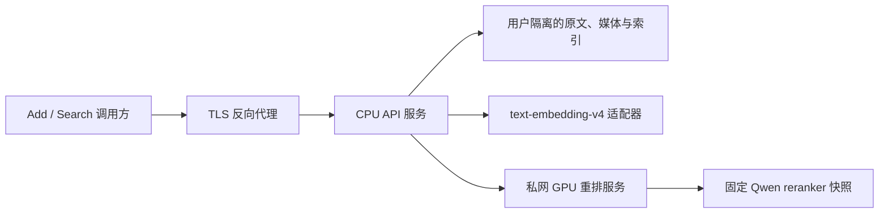

# Docker 部署预览与 V6 服务化路线

2026-10-26。本仓库已完成 V6 研究实验；这里提供的是现有确定性 Add/Search 服务的容器部署预览，尚不是成绩对应的 V6 在线服务，也不是正式发布版。`/health` 会明确返回 `deployment_profile=deterministic_container`、`experiment_v6_online=false`。配置为其他模式会启动失败，不会静默切换到基线。

“离线实验”指固定数据通过脚本完成检索、重排、回答和评分。它实际使用了 GPU 与模型 API；“在线服务”则需要持续接收新 Add/Search，并在新数据上维护和查询索引。这两种运行方式不能仅靠添加 Dockerfile 相互替代。

## 当前容器交付

- Linux Python 3.11 镜像，固定 Gunicorn 26.2.0 wheel 与 SHA256；只复制 `agent_memory/` 和 `deploy/`。
- 独立 WSGI factory，继续使用现有 Application、SQLite 及用户隔离逻辑；不修改只允许回环地址的开发 CLI。
- 一个进程、四个线程，保持 Add 的进程内写锁；每次操作使用独立 SQLite 连接。没有声称启用了 WAL，也没有进行多副本写入验证。
- 非 root UID/GID 10001、只读根文件系统、`/tmp` 临时盘、`/data` 持久卷、健康检查与容器停机宽限。
- Add/Search 强制认证；服务 token 通过 Compose secret 文件挂载，不是模型 API key。`/health` 按现有协议免认证。
- 宿主端口固定绑定 `127.0.0.1`。Docker build context 采用允许列表，语料、QA、向量、账本、收据、模型和 Git 历史均不进入镜像。

## 启动步骤

在装有 Docker Engine 或 Docker Desktop **Linux containers** 和 Compose v2 的主机上，从本仓库根目录执行：

```bash
python scripts/init_container_secret.py
docker compose config --quiet
docker compose build
docker compose up -d --wait
curl http://127.0.0.1:8765/health
```

Windows 可用 `python`；Linux 若只有 `python3`，替换第一条命令即可。初始化工具只创建 `.secrets/service_token`，不输出 token，也不覆盖既存文件。在 POSIX 上，私有父目录为 0700，文件为 0644，以便非 root 容器通过显式挂载读取；Windows 依赖宿主目录 ACL。`.secrets/` 已被 Git 忽略。客户端使用该文件中的值构造 `Authorization: Bearer …`，不要把 token 写进仓库或 URL。

数据保存在 Compose 项目的 `memory-data` 命名卷；替换镜像、重建容器或普通 `docker compose down` 不删除该卷。备份应调用现有 SQLite backup API，例如：

```bash
docker compose exec -T api python -m agent_memory --db /data/system.sqlite backup /data/backup-20261026.sqlite
```

备份文件仍在同一卷中；实际运维还需把备份复制到独立存储。不要把实验工作区的共享预算数据库或原始语料目录当成服务数据库挂载。

## 独立测试卷验证

以下检查会写入固定合成图文，仅在独立 Compose 项目／测试卷中运行。它验证真实 HTTP、认证、幂等、冲突、用户隔离、图文原序与重建后持久化，不是官方 Smoke，也不调用模型：

```bash
docker compose -p tracemem-container-check up -d --build --wait
docker compose -p tracemem-container-check exec -T api python deploy/smoke_test.py seed
docker compose -p tracemem-container-check up -d --force-recreate --wait
docker compose -p tracemem-container-check exec -T api python deploy/smoke_test.py verify
docker compose -p tracemem-container-check down
```

若默认服务已占用 8765，先在 shell 中设置 `TRACEMEM_PORT` 为另一个空闲端口。脚本从容器内部访问 8000，宿主映射变化不会影响检查。测试卷默认保留，删除测试卷应由操作者明确选择。

当前 Windows 环境没有找到 Docker CLI／服务，已有 GPU1 主机的当前用户也找不到 Docker 命令。因此**镜像构建、Compose 启动和上述容器内检查尚未实际验证**。本地能验证 WSGI factory 与回环 HTTP 行为，不能把这些测试记为 Docker 构建成功。这里没有自动安装 Docker、启动公网服务或提交官方评测。

导出仓库 `python -B scripts/run_checks.py` 共 372 项通过。新增验证包含三种认证方式的实际回环 HTTP、合成图文 Add/Search、幂等／冲突、隔离，以及关闭后重建应用读取同一数据库；Compose YAML 语法解析通过，Docker Engine 的配置验证仍待执行。

## 真正部署 V6 还需要完成什么

建议保留两个计算组件，而不是把实验脚本作为 HTTP 请求处理器：



1. **在线 Add／索引**：将原文、原图与来源身份持久化；指定 embedding／视觉提取适配器使用 Linux 可用的 secret 注入与持久预算账本。一个来源未完成必要索引时不能提前返回成功。现有 Windows Credential Manager 入口不能原样放进 Linux 镜像。
2. **在线 Search**：按 `user_id` 从动态索引取固定候选，采用冻结的 Dense＋重排主候选与 Hybrid＋重排对照。V6 的已有 Top100 文件和公共开发集缓存不能充当在线新用户的检索数据。
3. **重排组件**：固定模型版本，启动时只加载一次，通过私网批量打分；GPU 编号、显存预算、队列容量、超时和过载策略在服务层定义。不能在每次 Search 中启动一次实验 worker。遇到错误应报告失败或明确标注预先定义的降级模式，不能把降级结果包装为 V6。
4. **一致性与可靠性**：验证并发 Add/Search、索引恢复、断电后幂等、未知 provider 结果不重发、模型服务不可用和版本迁移；先通过独立场景端到端验收，再确定正式版本号和镜像 digest。
5. **外部可用性**：确认实际部署主机、域名、TLS 与网关配置。当前共享服务 key 只认证调用方，不是每用户账户 ACL。公开多租户服务需要另行建立 key 与 `user_id` 的授权关系。

平台调用的是 Add/Search；实验用 Reader 和 judge 用于评价，不应在每次 Search 内自动追加回答／评分调用。原 79 次实验的 guard 都已关闭，部署使用独立服务状态，不能重开实验计数。

协议支持较长的同步请求，但 Gunicorn 的 gthread `timeout` 是 worker 活性检测，不是逐请求截止时间。现配置的 1900 秒活性／停机宽限及 Compose 1950 秒停机宽限也不构成 30 分钟 SLA；网关的请求体上限、读写超时、客户端期限和负载测试必须一起完成。代理至少应容纳应用的 64 MiB HTTP 上限；原始媒体仍遵守单图 10 MiB、单次 30 MiB 解码总量约束。

正式发布时应把基础镜像固定到已验证 digest，并保存构建、容器验证和线上健康证据。当前 `python:3.11-slim-bookworm` 是可更新 tag；不能声称逐字节可复现的镜像已交付。

## 依据

- [Gunicorn application factory](https://gunicorn.org/run/)、[线程与超时参数](https://gunicorn.org/reference/settings/)
- [Gunicorn 26.2.0 发布与 wheel](https://pypi.org/project/gunicorn/26.2.0/)
- [Docker Compose secrets](https://docs.docker.com/compose/how-tos/use-secrets/)、[服务配置](https://docs.docker.com/reference/compose-file/services/)
- [Docker volumes](https://docs.docker.com/engine/storage/volumes/)、[端口发布](https://docs.docker.com/engine/network/port-publishing/)
- [当前 V6 结果](v6-results.md)、[服务协议](protocol.md)
