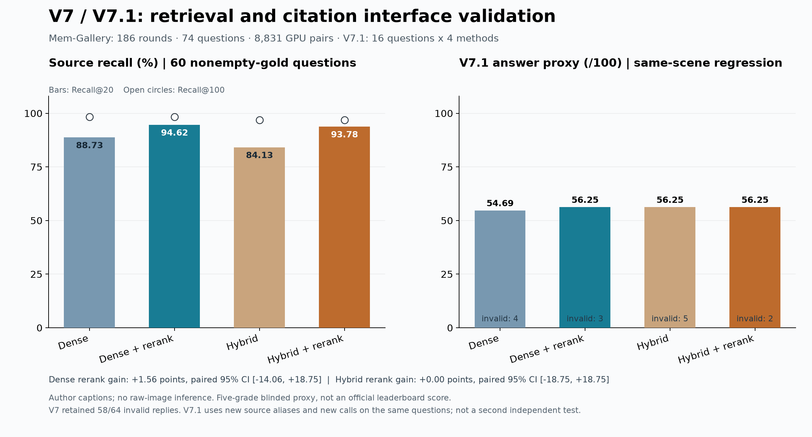

# V7 / V7.1：独立场景检索与引用接口回归

本轮已经完成。Dense＋重排在新场景的 Recall@20 最高，为 **94.62%**；16题回答 pilot 中，Dense＋重排、Hybrid、Hybrid＋重排均为 **56.25/100**。回答差异的配对区间跨零，尚未证明重排带来稳定的最终回答提升。Dense＋重排继续作为主候选，保留 Hybrid 对照；V7.1 仍是研究版本，默认在线服务未切换，Docker 暂缓。

## 实验范围

按场景名顺序选择本项目此前未读取的下一完整 Mem-Gallery 场景，选择规则在下载前冻结。固定 Hugging Face revision 为 `af912daba984e896e253016b7c7e334ef92c2a6f`。完整保留186轮、372条消息及所有干扰来源；74题中14题的证据为空，Recall单独排除并报告，因此召回分母为60题。

条件是**原始对话＋作者提供的来源/查询图片描述**：30个来源图片引用、6个带图查询均保留原始映射与caption。本轮没有原图下载、视觉推理或生成新caption，不能称为严格原图端到端评测。新场景仅指此前未被本项目评估，不能保证对模型或其他研究者未见。

27次真实 `text-embedding-v4` 调用生成186个来源、74个查询向量，256维。Dense与Hybrid各取自己的Top100；Hybrid使用BM25与Dense的等权RRF60。固定的 `Qwen/Qwen3-VL-Reranker-2B` 在四张既有空闲GPU上完成8,831个去重候选对，打分后保留各方法原Top100集合，只调整顺序。模型revision为 `4bd860ac4f15ad1897a214615cccc700f8f71818`。未用gold选择来源、调整排名或挑题。

## 完整检索与回答结果

| 方法 | Recall@20 | Recall@100 | V7.1回答代理分 /100 | 无效回答 /16 |
|---|---:|---:|---:|---:|
| Dense | 88.73% | 98.33% | 54.69 | 4 |
| Dense＋重排 | **94.62%** | 98.33% | **56.25** | 3 |
| Hybrid | 84.13% | 96.94% | **56.25** | 5 |
| Hybrid＋重排 | 93.78% | 96.94% | **56.25** | 2 |

重排的Recall@20增量：Dense **+5.89个百分点**，Hybrid **+9.66个百分点**。Top100召回不变，符合候选集固定的设计。

Reader使用预先按任务类别和固定哈希抽取的16题，覆盖9类任务，四条件共64份回答。每份完整放入20条来源，预算一致：8192 text tokens、24000 UTF-8 bytes、0张原图、768输出tokens。评分为8个真实 `gpt-4o-mini` 盲评批次的五档代理分；无效回答仍计零。

Dense重排回答增量为 **+1.56分，95%配对bootstrap区间[-14.06,+18.75]**；Hybrid为 **0分，区间[-18.75,+18.75]**。每组只有16题，类别分层抽样也不代表完整74题分布；区间仅是描述性小样本结果，未调整共享证据依赖或多重比较。不能根据这个pilot宣称端到端稳定提升或榜单领先。

[上游评价代码](https://github.com/YuanchenBei/Mem-Gallery/blob/a93959e1e978a6a7d77798ae92c2ffe41c538c62/benchmark/memengine/evaluate/evaluation.py)与其提示存在五档/三档处理差异。本轮明确采用0、0.25、0.5、0.75、1的盲评proxy，没有伪称官方代码复现。V6的ATM混合代理分与本轮不同，不横向比较其绝对数值。官方Smoke、Full和榜单提交均为0。

## V7到V7.1的工程变化与失败保留

原V7的64份真实回答有58份严格无效：56份引用不是所提供的复合source ID，另2份拒答状态不一致。原始回答和收据全部保留，没有按gold补写或通过重解释引用来恢复分数，也没有花8次调用给这些占位符打分；原64次guard已关闭。

V7.1将完整来源库映射为稳定短编号 `M0001` 等，仅替换来源头的source ID并追加引用格式说明。四条件的题目、来源正文、图片ID、日期、20条来源顺序和预算逐条验证一致。它是**同场景接口工程回归**，64份回答是新的实际推理，不能当成第二次独立场景复现。

新64份回答中的引用ID错误降为 **0**，剩余14份无效全部是拒答文字与confidence字段不一致，仍按原规则计零。接口可靠性因此仍不足以宣布正式发布。

两次集成失败均独立保留：第一次temperature参数被本地旧适配器拒绝，0次HTTP/0新增账本attempt；兼容入口保留相同payload、单独执行。随后首个Judge请求因JSON模式缺少明确JSON字样而返回HTTP400，0个评分生成。确认该400后保留其序号、收据和0.25元hold，关闭原65条guard；新8批只追加`Return JSON.`，盲化映射、参考与预测内容、评分rubric均不变，使用独立8次/2元guard完成。没有重发未知请求，没有重开已完成guard。

## 调用、费用与可复核产物

本轮累计 **164次真实provider请求**：27次embedding、原V7 reader64次、V7.1 reader64次、1次被拒Judge、8次成功Judge。另有1次未联网的本地guard claim。所有已执行paid guard已关闭，旧本地失败保留为明确未联网的诊断记录。

累计provider预留为 **35.60元**，包含本地失败的名义guard预留为35.85元，均计入既有500元总预算。成功响应usage：原reader USD0.03908340、新reader USD0.03835080、成功Judge USD0.00228285；加embedding 0.012547元，按明确的10 CNY/USD预算假设估算为 **0.80971750元**。该假设不是市场汇率或账单。HTTP400没有usage，费用未知、0.25元hold继续保留，未当作免费。总项目账本保守accounted为72.213562元、remaining为427.786438元。

复核报告均只发布聚合结果，不发布原题、答案、引用ID、私有响应或数据库：

- [完整检索](../reports/memgallery-v7-retrieval-scores.json)
- [V7.1回答得分](../reports/memgallery-v71-reader-scores.json)
- [原V7引用失败诊断](../reports/memgallery-v7-citation-format-diagnostic.json)
- [V7.1格式诊断](../reports/memgallery-v71-format-diagnostic.json)
- [完整调用与账本审计](../reports/memgallery-v71-judge-json-accounting-audit.json)

下一步优先在合成契约测试中简化拒答状态表达，再冻结新的独立场景验证；保留Dense、Hybrid和各自重排四组。RAW-RAG的窗口检索、整轮回填尚未实现，本轮只验证了重排借鉴。不要在当前16题上继续调语义prompt或把新的结构变更包装成未见测试。Docker和在线Add/Search集成留待后续阶段。

工程验证：最终源码完整回归517项、发布副本完整回归493项均通过。工程测试数不属于benchmark样本或成绩。
